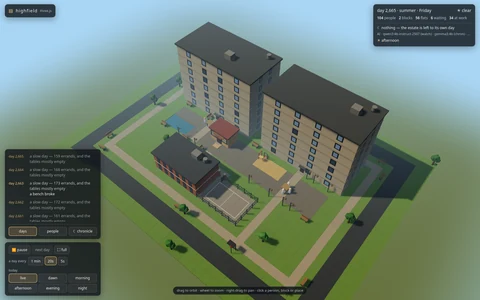
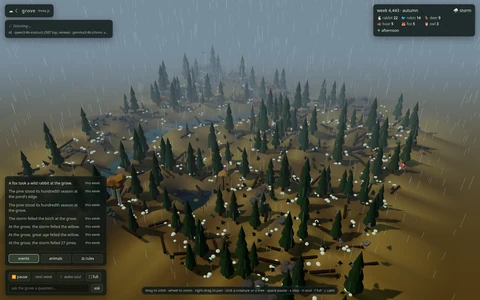
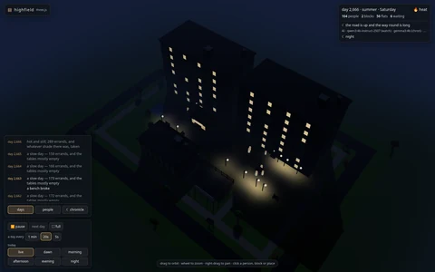
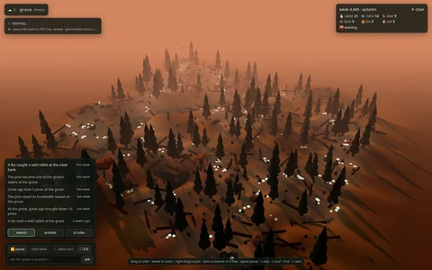
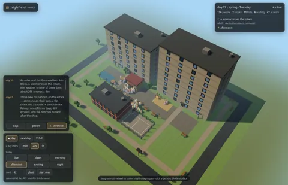

# llm-world

Small worlds that run on a small language model. Each one is
self-contained and deterministic per seed. The model can't break it: the
simulation owns every fact, and the LLM is a voice let into it.

<table>
  <tr>
    <td align="center" width="50%">
      <a href="apps/estate#readme"></a><br>
      <a href="apps/estate#readme"><b>Highfield</b></a>: a housing estate
    </td>
    <td align="center" width="50%">
      <a href="apps/grove#readme"></a><br>
      <a href="apps/grove#readme"><b>Grove</b></a>: a forest biome
    </td>
  </tr>
  <tr>
    <td align="center"><a href="apps/estate#readme"></a></td>
    <td align="center"><a href="apps/grove#readme"></a></td>
  </tr>
</table>

## The one design rule

> The simulation owns all state; the LLM only bends it. Every model output
> is schema-validated with a deterministic fallback, so the world can't
> break when the model writes nonsense, times out, or is unplugged.

No API keys and no pip dependencies. The engines are pure Python stdlib
(3.11+), and the model is reached through your own
[Ollama](https://ollama.com).

## The worlds

| app | the world |
|---|---|
| [`apps/estate`](apps/estate) | **Highfield**: a row of tower blocks, a courtyard with a shop and a playground, a school, a bus stop, and the households who live there. A watcher with no stake sends the weather and the small fates. |
| [`apps/grove`](apps/grove) | **Grove**: ponds and pines, rabbits and foxes, seasons and succession, and a World Soul that picks the forest's fates. |

Each app is a whole world, with its own engine, tools, docs, launcher,
`--data` directory and gate. Both are watched in the same kind of
full-window 3D view (Three.js, vendored, no build step, works offline)
with floating panels. The view code they share lives in
[`apps/shared`](apps/shared).

## Running them

```sh
# plant a fresh world (no model involved); --force archives the old one
apps/estate/estate.sh new --seed 42
apps/grove/grove.sh   new --seed 42

# serve the 3D view
apps/estate/estate.sh web --port 8787 --public
apps/grove/grove.sh   web --port 8789 --public
```

Open `http://<host>:8787` (the estate) and `http://<host>:8789` (the grove).
Leave out `--public` to bind loopback only. On station, both run with
`--tier local` and are reachable on the tailnet at
`station.tail8a1a2.ts.net:8787` and `:8789`.

Highfield also runs with no Python at all, in the browser, at
**[yakov.khalinsky.com/highfield](https://yakov.khalinsky.com/highfield/)**: a
TypeScript port of the estate in a Web Worker, with no server and no model.
From the same seed it grows the same estate, held to this repo's Python
engine (`apps/estate/tools/parity.py`, `export_rules.py`, `balance.py`) at a
pinned commit. Its code lives in its own repo,
[yakovkhalinsky/highfield](https://github.com/yakovkhalinsky/highfield).

<p align="center"><a href="https://yakov.khalinsky.com/highfield/"></a></p>

`new --force` never deletes anything: it moves the old world aside as
`archive-<stamp>-…db` in the same data directory.

## Rules decide, the model speaks

Both apps split the work the same way:

- **Rules make every choice.** With `--decide rules` (the default),
  `decide.py` answers each menu question from a seeded weighting of what
  the world is showing. The answer goes through the same validator a
  model's would, so the world moves the same way with or without a model.
- **The model writes the words**: the watcher's or soul's line of why, the
  chronicle, and (in the grove) names and answers to questions. Each call
  has a small JSON schema sent as Ollama's `format`. If the answer is
  missing, malformed or late, a template line is used instead.
- `--decide llm` hands the menu choice back to the model.
- `--offline` turns the model off entirely and doesn't run `decide`, so
  offline worlds and the gates' fingerprints are unchanged by it.

### Model flags

These are on `web` in both apps, and on `run` and `step` in the grove too.


| flag | default | what it does |
|---|---|---|
| `--tier` | `cloud` | `cloud`: try the cloud model first for each job, then that job's local model, then the other local model, then `llama3.2:3b` if it's installed. `local`: never leave the box. (The grove also accepts `hybrid`, an old name for `cloud`.) |
| `--choice-model` | `qwen3:4b-instruct-2507-q4_K_M` | menu-shaped jobs (the watcher, the World Soul, the steward) |
| `--prose-model` | `gemma3:4b` | prose jobs (the chronicle, names, ask the grove) |
| `--embed-model` | `nomic-embed-text` | grove only: ask-the-grove's chronicle vectors |
| `--cloud-model` | `deepseek-v4.1-flash:cloud` | with `--tier cloud`, tried before the local models |
| `--decide` | `rules` | `rules`: choices are made in code; `llm`: the model picks from the menu too |
| `--keep-alive` | `2m` | Ollama's `keep_alive` on every call (`0` unloads at once) |
| `--resident` | `one` | `one`: unload this app's other local chat model before loading a different one; `many`: leave that to Ollama |
| `--model-lock` | `/tmp/llm-world-ollama-<uid>.lock` | a file every llm-world process of this user locks around a call, so the two apps take turns; `''` = this process only, which lets one app unload the other's model mid-call, so they thrash |
| `--lock-wait` | `60` | seconds a call waits for its turn before giving up and keeping its template |
| `--model NAME` | `auto` | `auto`: the per-job defaults above; a name pins every chat job to that one model |
| `--offline` | off | no model at all, and no watcher, soul or steward either. Only an *unreachable* Ollama keeps them running on rules |

Pull the local defaults once (there's no bare `qwen3:4b-instruct-2507`
tag, so use the quantised one):

```sh
ollama pull qwen3:4b-instruct-2507-q4_K_M
ollama pull gemma3:4b
ollama pull nomic-embed-text      # the grove's ask box
```

**A missing model says so.** Each job's chain is filtered to what Ollama
has installed. The HUD's status line and the `models` block in
`/api/state` (under `llm.models` in the grove) name each job's model, and a job whose model isn't
installed shows up as `not installed: … (jobs on templates)`. It doesn't
fail silently. A model that keeps failing moves its job along the chain.
If every model in the chain fails, the job reads **failing** and is
retried a minute later. An unreachable Ollama is re-probed in the
background every 60 s, and the sim never waits on it.

**Memory on a small box.** Station is a Raspberry Pi 5 with 16 GB, and
both apps share one Ollama there. A 4B q4 model takes about 2.5–3.5 GB, so:

- calls are serialised within a process and, through `--model-lock`,
  across the two apps. Waiters take turns, and every wait is capped by
  `--lock-wait`.
- `--resident one` keeps only one local chat model loaded at a time. The
  embedder and cloud models are exempt, and another program's models are
  left alone.
- `--keep-alive 2m` lets a model go sooner than Ollama's default five
  minutes. On a bigger box, `--resident many --keep-alive 10m` keeps both
  warm.

If the two apps use different chat models with `--resident one`, they swap
models on every turn. Share the default lock, put both apps on the same
models, or use `--resident many`.

## What the two share

Mostly lessons, plus the view code in `apps/shared`. Grove was built
first and kept a worklist of 52 bugs. These boil down to sixteen ways
the design rule goes wrong: a field nothing reads, one fact kept in two
places, a validator that disagrees with what it's fed, a failure swallowed
silently, a threshold with no good value. Estate was built under those
sixteen as written constraints, and its README carries the table.

Two ideas are common to both, because they are what the worlds are *for*:

- **A world with nothing left to want is a dead world.** Grove keeps its
  ecology off equilibrium with density-dependent predation and a seed bank
  that never empties. The estate makes a place offer less the fuller it
  is, and treats quiet as something everyone shares, which a lively
  estate can never fully supply.
- **The record is the point.** Each app keeps a `docs/BUGS.md` logging
  what went wrong and why, with the fixes that failed written down beside
  the ones that worked.

## Layout

| path | role |
|---|---|
| `apps/estate/` | the estate: package, tools, tests, docs, launcher |
| `apps/grove/` | the forest: the same shape |
| `apps/shared/` | the 3D views' shared code: Three.js, the day clock, the router, the light field, the panels' list writer |
| `docs/screenshots/` | the READMEs' screenshots, taken from the live demos on station |
| `LICENSE` | MIT, one licence for the lot |
