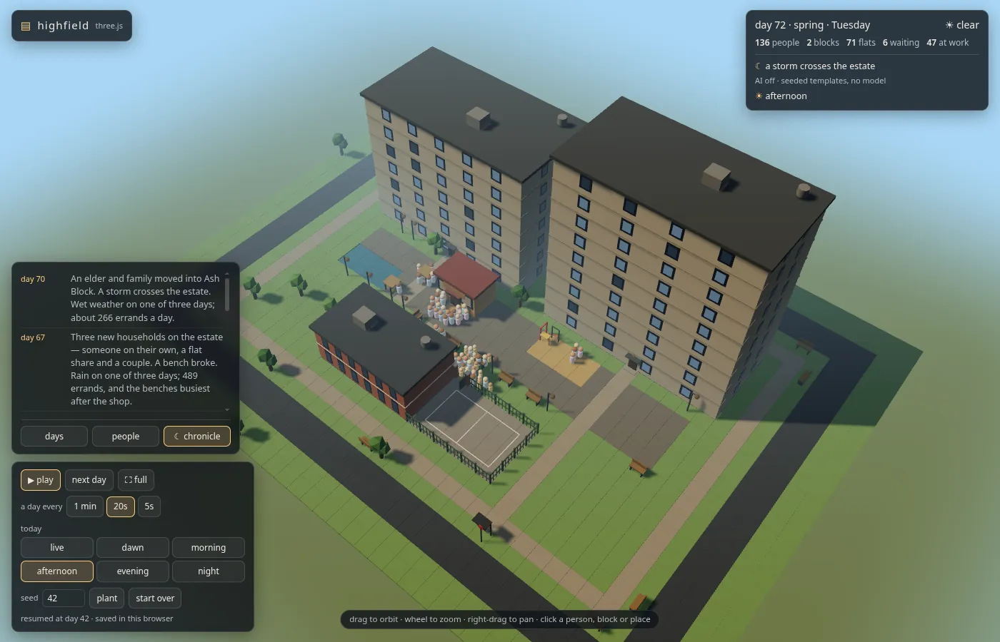
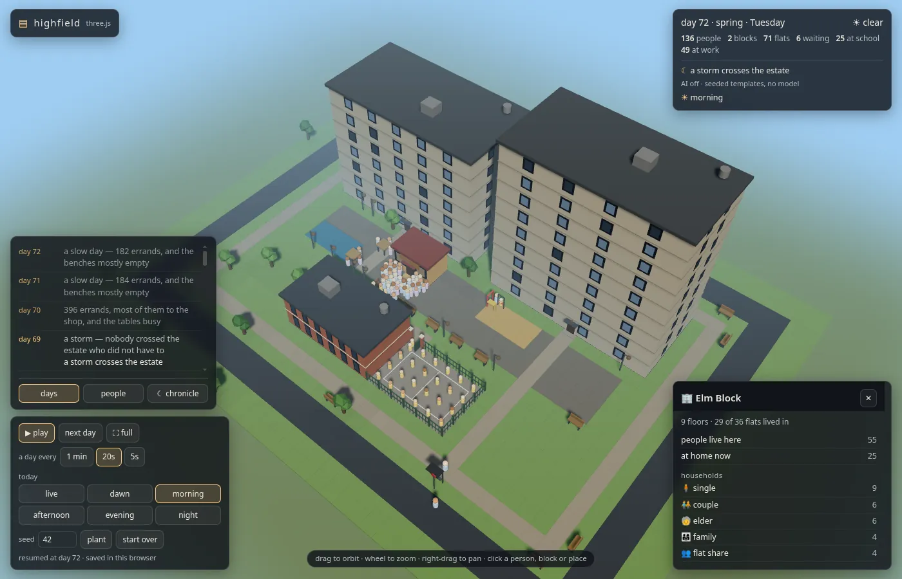

# estate-web: Highfield in the browser

A TypeScript port of [`apps/estate`](../estate) that runs entirely in the
browser. There's no server and no model. The simulation runs in a Web
Worker, the estate is saved in IndexedDB, and the whole app is a static
build that GitHub Pages (or any static host) can serve from a sub-path.

<p align="center">
  
</p>
<table>
  <tr>
    <td align="center"><br>night: the same gradual day as the Python app's view</td>
    <td align="center"><br>a block's card, only what is relevant to it</td>
  </tr>
</table>

```sh
npm install
npm run dev       # the page on Vite's dev server
npm test          # unit tests, parity against the Python engine, the page
npm run build     # typecheck, then the static site in dist/
npm run preview   # serve dist/ as it will be served
```

`npm test` and `npm run parity` need `python3` (3.12 or later) on your PATH.
Nothing else does: the page itself needs only a browser with Web Workers
(and WebGL for the 3D view; without it the page falls back to page3d's
plain-text frame).

## How it works

| piece | what it is |
|---|---|
| [`src/sim`](src/sim) | the engine, ported function by function from `apps/estate/estate`: world generation, the day's tick, residents' `decide()`, families, households and the watcher's rules (`--decide rules`). It reads the Python engine's own rules, exported to [`src/sim/rules.json`](src/sim/rules.json). |
| [`src/py`](src/py) | Python's `random`, rounding, floor division, `sum` and `repr` in TS, so the same seed draws the same numbers (below). |
| [`src/view/runner.ts`](src/view/runner.ts) | the Python runner's loop: tick, keep the last 400 events and 64 day books, let the watcher look when the seed says it is due, then write the chronicle. |
| [`src/view/api.ts`](src/view/api.ts) | web.py's four endpoints (`/api/ground`, `/api/state`, `/api/plain`, `/api/control`) answered from that state, with the same JSON. |
| [`src/worker`](src/worker) | the Web Worker that holds the estate, keeps its pace and saves it to IndexedDB after every day. |
| [`src/main.ts`](src/main.ts) | the page: it answers page3d's `fetch('/api/…')` calls from the worker, then starts page3d's viewer. |

**The page is the Python app's page.** The 3D front end is
`apps/estate/estate/page3d` and `apps/shared/page3d`, reused byte for byte
and never forked. [`vite.config.ts`](vite.config.ts) serves those files at
`3d/` in dev and copies them in the build. It also rewrites `index.html`:
the paths become relative, the seed row is added, and `src/main.ts` stands
in for `viewer.js`. Each rewrite fails the build if page3d's page has
changed under it.

**Time comes from the seed.** The wall clock sets only the pace: a day every
1 minute, 20 seconds or 5 seconds, paused, or stepped. Everything else is
counted in days from the seed:

- which day comes next;
- when the watcher next looks;
- what the watcher chooses;
- which words the chronicle uses.

So a saved estate that is resumed is the estate it was, and two browsers
with the same seed at the same day have the same estate.

**Saves.** Each seed is saved separately in IndexedDB, after every day.
Open `?seed=42` to resume that estate, or plant it if it is new. "start
over" plants it again from day 1. With no `?seed=`, the last estate you had
open comes back. The HUD says whether the estate is being kept: "saved in
this browser", or "not saved" and why (IndexedDB unavailable, as in some
private windows; storage full; or the seed already open in another tab,
which alone holds it). The estate runs either way. A save from an older
format or older rules, or one that doesn't have the shape of a run, is
never half-loaded: that seed is planted again instead. If the estate
stopped with an error last time, the page says on opening which day it
stopped on and that it will stop there again, and that "start over" plants
it afresh.

## Words without a model

In apps/estate, a model writes the chronicle and the watcher's why. Here,
both come from seeded templates sifted from what actually happened
([`src/view/narrate.ts`](src/view/narrate.ts)):

- **The chronicle.** A paragraph every three days
  (`pacing.chronicle_need`, as `chronicler.worth_writing` counts). The last
  40 are kept and the last 8 are shown.
- **The watcher's why.** One sentence on why the watcher sent what it sent,
  written after the choice.

The rules a model was only asked to keep are enforced here, and tested over
a year of three seeds:

- **Only what happened.** Every death, birth, storm, fallen tree, move,
  sold-out shop and count of errands or wet days is read off that stretch's
  events and day books. If a fact isn't there, no template can say it.
- **Nobody invented.** The only people named are residents in the
  stretch's events or residents fraying right now.
- **No repeats.** Recently used templates are held back while others fit
  (the why's and the chronicle's are remembered apart).
  No chronicle entry is word for word one the estate still keeps.

A few sample entries from seed 1:

> **day 4** A storm crosses the estate. A bench broke. 85 errands over three days, the most on Thursday (40).
>
> **day 19** The sky opens over the estate. A storm came through. Wet weather on two of three days, and the benches the place to be.
>
> **day 730** Dev and Ada were born on the estate. Spring came in. Three dry days, and the tables the place to be.

The world never reads these words. The templates draw from generators of
their own (`rngFor(seed, day, "chronicle")`), so they never change the
estate they describe. The HUD says so: "AI off · seeded templates".

## Deploying to GitHub Pages

The build uses relative paths throughout (`base: "./"`), so `dist/` works at
the root of a domain or under a sub-path such as
`https://<user>.github.io/llm-world/`. There is nothing to configure.

```sh
npm ci && npm run build      # dist/ is the whole site
```

Then publish `dist/` in either of these ways:

- **From Actions.** Set Settings → Pages → Source to "GitHub Actions" and
  add a workflow that builds `apps/estate-web` and runs
  `actions/upload-pages-artifact` (path `apps/estate-web/dist`), then
  `actions/deploy-pages`.
- **From a branch.** Push the contents of `dist/` to a `gh-pages` branch
  and choose that branch as the Pages source.

This repo doesn't deploy it for you; that step is left to whoever owns the
Pages site. To check a build the way Pages serves it, serve its parent
under the sub-path:

```sh
mkdir -p /tmp/pages && ln -sfn "$PWD/dist" /tmp/pages/llm-world
python3 -m http.server 4185 -d /tmp/pages   # open http://localhost:4185/llm-world/
```

## The bar: same seed, same estate

The port has to produce the same estate as the Python engine from the same
seed. It is not enough for it to be similar.

```sh
npm install
npm test          # the shims against CPython, rules.json freshness, and gen parity
npm run parity    # Python vs TS world hashes, seeds 1-8, 42 and 3771
```

Run `npm test` and `npm run parity` from this folder, with `python3` (3.12
or later) on your PATH. They call [`../estate/tools/parity.py`](../estate/tools/parity.py),
a read-only hook that plants worlds in memory and prints:

- each world's canonical hash; and
- CPython's reference values for the shims.

If two worlds differ, the harness reports the first JSON path where they
diverge.

**The canonical form.** Keys are sorted and there are no spaces. Tuples
become lists. Any integral number below 1e16 is written as an integer, and
every other number is written as Python's `repr`. The TS twin is
[`src/py/canon.ts`](src/py/canon.ts), and the hash is sha256 cut to 16 hex
characters.

**What can't match, and why it doesn't matter.**

- **Python's int/float distinction.** JS has only one number type, so the
  hash doesn't see this difference. Every value still agrees, and no engine
  code reads the type. The one place the type shows is `json.dumps` in the
  gate fingerprint, where the port marks which fields are floats.
- **`sum()` before Python 3.12.** Python 3.12 made `sum()` of floats
  Neumaier-compensated. The port does the same, so the Python side of the
  test needs 3.12 or later. The engine itself still runs on 3.11.

## The Python shims (`src/py`)

| Python | TS |
|---|---|
| `random.Random(str)`: sha512 seeding, MT19937, `random`, `getrandbits`, `randrange`, `randint`, `choice`, `shuffle` | `PyRandom` |
| `round(x)` (banker's) and `round(x, n)` (rounded on the exact binary value, ties to even) | `pyRound` |
| `//`, `%` and `divmod` (the divisor's sign) | `floordiv`, `mod`, `divmod` |
| `sum` (compensated) | `pySum` |
| `repr(float)` | `floatRepr` |
| `max`/`min` with `key=` (the first of any ties wins) | `maxBy`, `minBy` |

The rules come from `src/sim/rules.json`, which `npm run rules` exports from
the Python engine's `rules.R`. A test fails if the JSON drifts from what
the engine reads.
`npm run rules` uses POSIX shell syntax (`${PYTHON:-python3}`, `mv`), so on
Windows run it from Git Bash or WSL rather than cmd; everything else is
plain Node.
