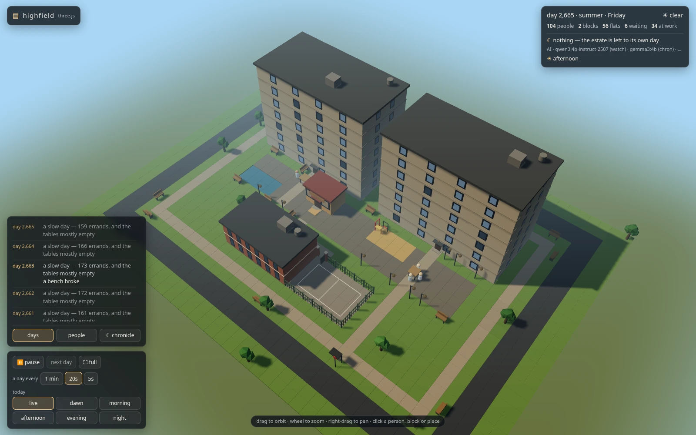
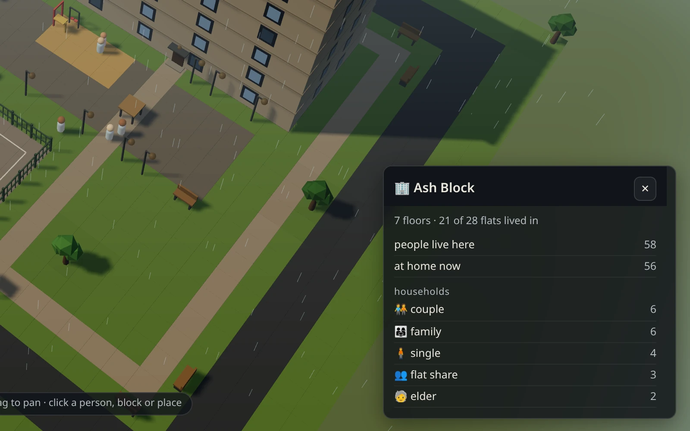
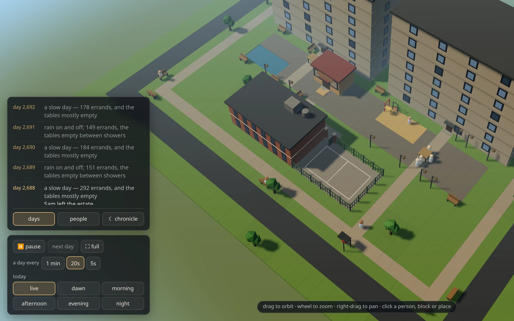
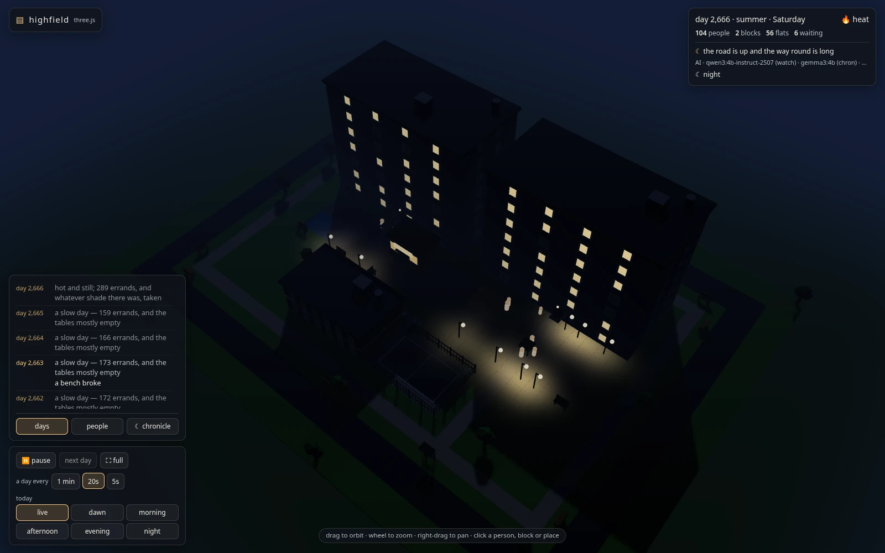

# Highfield: a housing estate that lives



A self-contained estate on a small language model. A row of residential
blocks runs along the north. In front of them are open ground and a
courtyard, with a shop, a playground, benches, trees and a school, and
the people who live among them: going out, coming home, wearing the
swings out, falling out with the neighbours, moving away, moving in.

Nothing here waits on the model. The engine owns every fact, and the
world is fully deterministic per seed. A small LLM is **a watcher with no
stake**: it sends the weather and the odd small fate, and its words become
the estate's diary.

| | |
|---|---|
|  |  |
| A card: click a block, a resident, a fixture or a patch of ground | The days feed and the controls |
|  | |
| Night: lived-in flats light up, empty ones stay dark | |

## Running it

Python 3.11+ (stdlib only); Ollama is optional.

```sh
./estate.sh new --seed 42      # plant an estate (deterministic, no LLM)
./estate.sh step 100           # advance 100 days, headless
./estate.sh run                # watch it in the terminal
./estate.sh web --port 8787 --public            # the 3D view, on the LAN
./estate.sh web --port 8787 --public --tier local   # as station runs it
./estate.sh map                # the terminal glyph map, once
./estate.sh status             # census history
./estate.sh rules              # the live ruleset
python3 tools/balance.py       # the gate: 8 estates, years, every law
python3 -m unittest discover -s tests
```

The world lives in `--data` (default `./estate_data`, next to
`estate.sh`). `web` refuses to start until an estate has been planted.

**A fresh world.** `new --seed N --force` plants a new estate over an
old one. The old database isn't deleted: it's moved aside as
`archive-<stamp>-d<day>.db` in the same directory. `--size WxH` (default
`40x30`) sizes the plan, from 36×28 up to 64×44. A plan too small for
the school says so.

Without `--public` the server binds loopback only. The page's buttons
are POSTs, and the server answers them only from the page itself: a JSON
body, a matching `Origin`, and a `Host` it knows. That's loopback, plus
with `--public` this box's LAN address and station's tailnet name. Add
another name with `--allow-host NAME`. Opened by any other name, the page
still shows, but its buttons get a 403.

## The view

There's one view, in 3D, at `http://<host>:8787/`. `/3d` and `/3d/`
serve the same page, kept for old links. It shows solid blocks with their
floors, doors and windows, the fixtures in their cells, and the residents
walking from where they were to where they are now. The light runs on one
continuous day clock through five phases: dawn, morning, afternoon,
evening and night. The sun crosses the sky, lived-in windows warm at dusk
while empty ones stay dark, and lamps lay pools of light. The seasons
turn the grass and the trees, and rain falls as streaks. A paused day
freezes the light where it is.

Drag to orbit, wheel to zoom, right-drag or the arrow keys to pan.

The panels float over the scene:

- **Top right:** the day, season, weekday and weather. Then the counts:
  people, blocks, flats, waiting, and how many are at school and at work.
  Then the watcher's last word, the model's status line, and the phase.
- **Bottom left, three tabs:** **days** (one row per day, newest first,
  quiet days included), **people** (households by kind, people by role)
  and **☾ chronicle** (what the watcher has written). A list keeps your
  place while new rows arrive above it.
- **Controls:** **⏸ pause**, **next day** and **⛶ full**. "A day every"
  **1 min / 20s / 5s** sets the pace (`pacing.day_seconds` in the pack).
  "Today" **live / dawn / morning / afternoon / evening / night** redraws
  today as it stood at the end of that phase: the school run at dawn, the
  pupils in the yard, the pickup at the gate, families out in the evening.
- **Cards** (bottom right): click or hover a resident, a block, a fixture
  or a patch of ground. Each card describes its own place. The school's
  gives the roll and who's in, the bus stop's who works off the estate, a
  fixture's how often it's used, and a block's its flats and households.

Three.js r170 is vendored in [`../shared/page3d/vendor/`](../shared), so
nothing is fetched from a CDN and the view works offline. If WebGL won't
start, the page shows the server's glyph map from `/api/plain` instead.

**URL parameters** for screenshots and checks:

| parameter | effect |
|---|---|
| `?phase=night` | freeze the light mid-phase (`dawn`, `morning`, `afternoon`, `evening`, `night`; also `day`, `dusk`, `sunrise`) |
| `?clock=0.2` | pin the day's fraction (0 = midnight; phases start at 0.1, 0.3, 0.5, 0.7, 0.9); wins over `?phase=` |
| `?static=1` | draw the first state and stop |
| `?view=top` | start overhead |
| `?focus=bench` / `perimeter` / `x,y` | frame the busiest bench, a stretch of the outer path, or a cell |
| `?show=morning` | open on a phase of today, as the "today" buttons do |

Once it's drawn, the page publishes `window.__estate3d` (`ready`,
`residents`, `buildings`, `benches`, `seated`, `outside`, `walking`,
`perimeter`, `phase`, `dayFrac`) for headless checks.

## The model

Without a reachable Ollama the estate keeps going: the watcher still
sends its fates from the same rules, and the chronicle keeps its
templates. `--offline` is different. It turns the watcher off entirely,
so no fates arrive, only the estate itself (`web.py`'s `_maybe_watch`
returns at once with no model). With a model:

| job | kind | default model |
|---|---|---|
| the watcher's daily fate (its line of why) | choice | `qwen3:4b-instruct-2507-q4_K_M` |
| the chronicle | prose | `gemma3:4b` |

**Rules decide; the model speaks.** With `--decide rules` (the default),
`decide.py` picks the day's fate and region from seeded weights over what
the estate is showing. The model writes only the watcher's line. A
missing model, a full queue or a bad answer lands the same choice with a
template line. `--decide llm` lets the model pick from the menu, under
the same validator.

The flags (`--tier`, `--choice-model`, `--prose-model`, `--cloud-model`,
`--decide`, `--keep-alive`, `--resident`, `--model-lock`, `--lock-wait`,
`--model`, `--offline`) are shared with the grove and described once in
the [root README](../../README.md#model-flags). The estate has no
embedding job, so it has no `--embed-model`.

## The world

- **A day is a tick**, resolved in five phases, so a day is a life rather
  than a snapshot.
- **The plan** is a rectangle of road, path, paving, lawn, playground,
  water and building footprints. The blocks stand in one row along the
  north, doors facing south, so the view from the south-east sees the
  ground in front: the courtyard with its shop, pond, playground, tables
  and benches. A footpath with ten more benches runs round the edge.
- **The places.** The shop and the playground stand apart in the
  courtyard, each within reach of every door so the 10–15s can go alone.
  South of it is **Highfield School**, with a fenced yard. On the ring
  road is the **bus stop**, which takes the day's workers off the estate
  and brings them back.
- **The weekday.** On a school day pupils (5–15) go to the gate at dawn:
  an under-10 always with a guardian, a 10–15 alone. At home time an
  under-10 waits inside until a guardian collects them. Adults with a job
  take the bus in the morning and are back by evening. A household with
  young children keeps a carer on the estate. Weekends have none of this.
- **Five needs**: food, rest, company, play (children only) and quiet.
  They're met at the places that afford them, and they interfere by
  design. A need is chosen before a place, so the nearest bench doesn't
  beat a meal just by being nearest.
- **Fixtures** (benches, the playground, tables, the shop, lamps, trees)
  are used, wear and break. A bench seats two; anyone else stands beside
  it. A lamp affords nothing by itself: it makes what it lights worth
  more in the evening.
- **Families mind their little ones.** A child under ten is never out
  without a guardian from their household, and never home alone. Minder
  and children choose and walk as one party, and a household with young
  children is home by night. `tools/family_check.py` counts every breach.
  It finds 0 on seeds 1–8 over three years, and exits non-zero otherwise.
- **Being inside is a state, not a coordinate**, and a walk goes round a
  wall, never through it.

**What keeps it from settling into a metronome:** a place affords less
the busier it is, use wears things out, and quiet is a commons that noise
spoils. A lively estate can never fully supply quiet.

## The constraints this project was built under

Highfield inherits Grove's design rule, and the sixteen ways that rule
was found to go wrong across Grove's recorded bugs.
[`docs/BUGS.md`](docs/BUGS.md) files every estate fault under one of
them:

| the rule | the failure it prevents |
|---|---|
| Every field has a named reader; a config key with no consumer is a bug | a whole subsystem built and never connected |
| One home per fact; no literal may duplicate a config default | two copies that drift apart |
| One schema for the given and the accepted; never silently rewrite a legal value | a validator that disagrees with what it's fed |
| Every accumulation declares its lifetime; an effect ages before the next lands | state that's written and never counted down |
| Never catch and continue silently; keep job, model, why and raw payload | a failure swallowed while the record said success |
| Anything that can degrade needs a recovery path with a cadence | a value computed once and frozen forever |
| Compute and draw in the same named space | a unit mismatch nobody can see |
| Attribute a cause from the pressure that hit *this* instance | an aggregate blaming the wrong thing |
| Defaults are live and obey the data they claim to obey | a subsystem switched off, quietly |
| Never truncate continuous state; test the smallest viable population | an accumulation that kills the small case |
| Persistence is atomic; rebuild from the ledger when records disagree | a file truncated halfway through a write |
| No catch-all identity default; resolve to your own data or fail loudly | a missing fact silently borrowing a sibling's |
| Never hold the world lock across a network call | a stalled world behind a slow answer |
| Regression-first: every check must fail on the unfixed code | a harness guarding the old behaviour |
| One geometry for a shared boundary; if a threshold has no good value, the model is wrong | two surfaces that never meet |
| Render every surface and look at it | the bug only an eye can catch |

## Checks

**The gate** is `tools/balance.py`. It runs seeded estates for years with
no model, and refuses any estate that has lost a household type, emptied,
gone quiet in the wrong way, or settled into a marching band. It prints a
fingerprint, so a change to the world's behaviour can't land unnoticed.
The current fingerprint is `f5d9ea5e95da827c`. How it got there is in git
history and `docs/BUGS.md`.

`python3 tools/audit.py` lists ruleset keys that nothing reads.
`python3 tools/family_check.py` is the families' check (above).

**The view** is checked without a browser, in Node, against the server's
own payloads (`/api/ground`, `/api/state`) or a live URL:

```sh
curl -s localhost:8787/api/ground > /tmp/g.json
curl -s localhost:8787/api/state  > /tmp/s.json
node tools/hud_check.js   /tmp/g.json /tmp/s.json   # panels, cards, escaping
node tools/walk_check.js  http://localhost:8787     # the router
node tools/clock_check.js                           # no jump in the light
node tools/patch_check.js                           # lists keep the reader's place
node tools/crowd_check.js /tmp/g.json /tmp/s.json   # nobody inside anybody
node tools/step_check.js  /tmp/g.json /tmp/s.json   # nobody walks through a step
```

`crowd_scene.js` builds a deliberately crowded day from a real one, for
the crowd check and for screenshots. `python3 -m unittest discover -s
tests` runs the wrappers too when `node` is on `PATH`, planting a fresh
seed-42 estate for them.

## Layout

| path | role |
|---|---|
| `estate/engine/` | the tick's domains: the sky, the plan, the people, households, the weekday, the watcher's fates |
| `estate/biomes/estate.py` | the estate's nature as a pack |
| `estate/rules.py` | the live ruleset, pack folding, JSON overrides |
| `estate/sim.py` | the engine's face: one import for callers (`tick`, `wetness`, `roll_weather`) |
| `estate/world.py`, `gen.py`, `db.py` | state and calendar; seeded generation (no LLM); SQLite |
| `estate/watcher.py`, `decide.py` | the watcher's menu, digest and validator; its choice made in code |
| `estate/llm.py` | the Ollama client: a model per job, status, one call at a time, never raises |
| `estate/chronicler.py` | the estate's record of its days, with or without a model |
| `estate/render.py` | the terminal view |
| `estate/web.py`, `webguard.py` | the server: the page, the state API, the tick thread; who may press the buttons |
| `estate/page3d/` | the 3D page: `viewer.js` (fetch, poll, pick, camera), `world.js` (the scene), `crowd.js` (placing and steps), `hud.js` (panels and cards); shared code from [`../shared/page3d/`](../shared) |
| `tools/` | the gate, the audit and the checks above |
| `tests/` | stdlib unit tests |
| `docs/BUGS.md` | every fault found, its class, its check |

Still deferred, each deliberately: money, traffic beyond noise, lessons
and a timetable inside the school day, illness, interiors as a grid, the
steward and embeddings.
