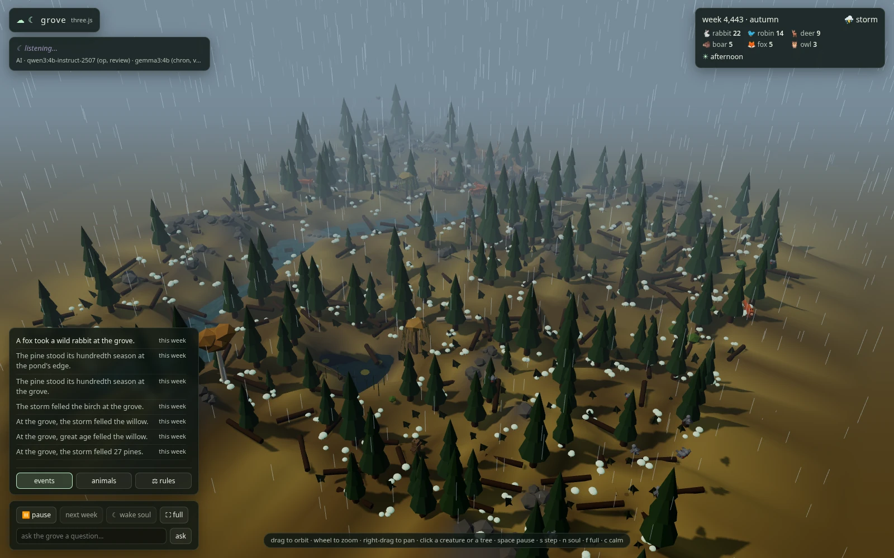
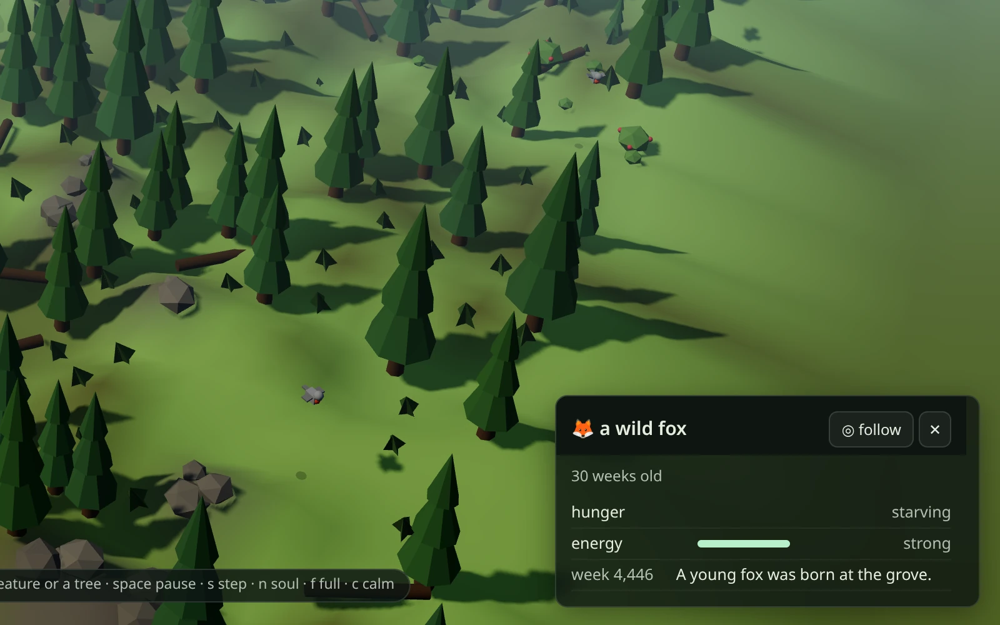
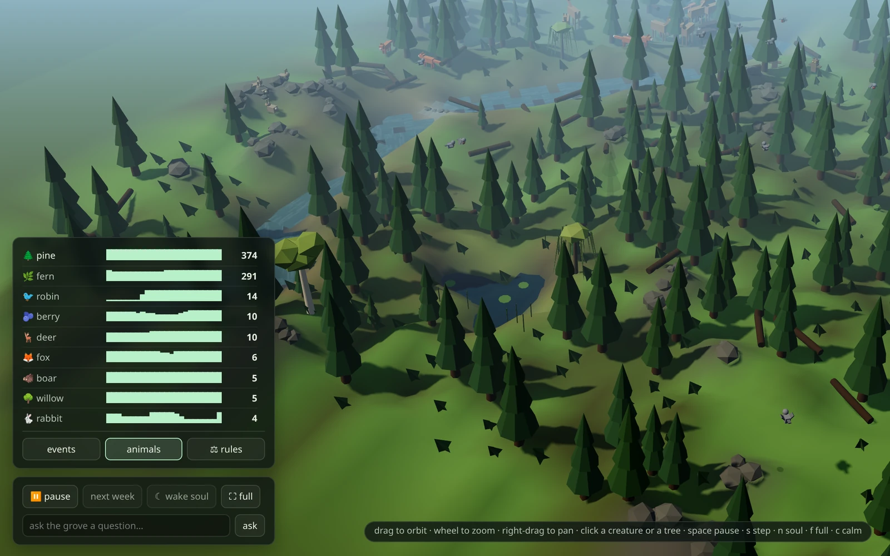
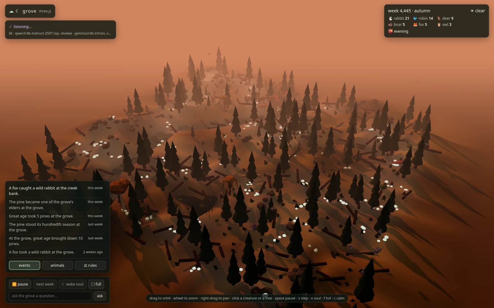

# Grove: a self-contained forest, given one voice by Ollama



A living forest biome that runs on your machine: ponds, pines, willows,
berry glades, grass and mushrooms, with rabbits, deer, foxes, owls,
robins and boars living, hunting, starving and being born through the
seasons. A **World Soul** picks the fate that befalls the woods every
minute or so: a storm, a drought, a blight, a bloom, a passing wolf. A
language model gives it words, writes the chronicle, names the newborns
and answers questions about the grove's history.

No API keys: even the cloud voice comes through your own Ollama. State
lives in one SQLite file. The engine is pure Python stdlib (3.11+).

| | |
|---|---|
|  |  |
| A card: click a creature or a tree, then **◎ follow** | The animals tab and the controls |
|  | |
| Dusk; after dark the mushroom rings glow | |

## Running it

```sh
./grove.sh new --seed 42        # plant a grove (deterministic, no LLM)
./grove.sh run                  # watch it in the terminal
./grove.sh web --port 8789 --public               # the 3D view, on the LAN
./grove.sh web --port 8789 --public --tier local  # as station runs it
./grove.sh step 200 --offline   # simulate ~4 years headless, fast
./grove.sh map                  # the terminal map, once
./grove.sh status               # population history with sparklines
./grove.sh chronicle --all      # the whole chronicle (☾ = model-written)
./grove.sh rules                # the biome's live ruleset
python3 tools/balance.py        # the gate
python3 -m unittest discover -s tests
```

`web` defaults to port 8787, the same as the estate, so pass `--port`
when both run on one box (station uses 8789). A week is 12 s of wall
time by default (`--tick-seconds`). Terminal keys: `space` pause, `s`
step, `n` invite the soul now, `q` quit. Every week is saved.

**A fresh world.** `new --seed N --force` plants a new grove over an old
one. The old database isn't deleted: it's moved aside as
`archive-<stamp>-wk<week>.db` in the same `--data` directory (default
`./grove_data`). `--size N` sets the map's width and height. The desert
is another nature entirely: pass `--biome desert` before the command,
every time (`./grove.sh --biome desert new --seed 42`).

**From another device.** With `--public`, open `http://<box>:8789` on
the LAN or the tailnet. Without it, the server binds loopback only (use
`ssh -N -L 8789:localhost:8789 <box>` to tunnel). The page's buttons
(pause, step, soul, ask, accept and dismiss) are POSTs. The server
answers them only from the page itself: a JSON body, a matching
`Origin`, and a `Host` it knows. That's loopback, plus with `--public`
this box's LAN address and station's tailnet name. Add another name with
`--allow-host NAME`. `tools/clean_servers.sh` ends every running grove
server.

## The view

One full-window 3D view at `/` (also `/3d`), with Three.js vendored in
[`../shared/page3d/`](../shared), no build step, and offline-safe. The
forest floor is lifted by the engine's elevation, with water lying in its
hollows and colours following the season. Trees and understory stand at
the size their stage gives them. Creatures walk to their weekly cells
round the trunks and the water, while robins fly. The light follows the
same day clock as the estate: a page day lasts a few grove weeks, and the
sun crosses the sky continuously. After dark the mushroom rings glow, and
there's rain, snow, lightning in storms, and fireflies over summer water.

Drag to orbit, wheel to zoom, right-drag to pan.

- **Top left:** the soul's latest move and the model's status line, for
  example `tier local · qwen3:4b-instruct-2507 (op, review) · gemma3:4b
  (chron, voice, ask) · choices by rules`.
- **Top right:** the week, season and weather, a chip per species with
  its count, and the phase of the day.
- **Bottom left, three tabs:** **events** (the chronicle, newest first),
  **animals** (each species counted week by week) and **⚖ rules** (the
  steward's suggested rule changes, to accept or dismiss).
- **Controls:** **⏸ pause**, **next week**, **☾ wake soul** (one change
  by the soul, only while paused), **⛶ full**, and *ask the grove a
  question…*, answered from the world's own chronicle.
- **Cards** (bottom right): click a creature or a tree for its state and
  history. Named souls show their biography (born, named, hunted,
  remembered). **◎ follow** keeps the camera on it.

Keys: `space` pause, `s` step, `n` wake the soul, `f` full screen, `c`
calm (hide the panels), `Esc` deselect. `?plain`, or a browser with no
WebGL, falls back to the glyph page from `/api/plain`.

**URL parameters:** `?phase=dawn|morning|afternoon|evening|night` freezes
the light, `?clock=0.2` pins the day's fraction, `?static=1` draws the
first state and stops, `?view=top` looks straight down, and `?focus=x,y`
frames a cell. The page publishes `window.__grove3d` once it's drawn.

## The model

| job | kind | default model |
|---|---|---|
| the World Soul's operator (its intent and a destiny's text), the steward's review | choice | `qwen3:4b-instruct-2507-q4_K_M` |
| the chronicle, names and diaries, ask the grove | prose | `gemma3:4b` |
| ask the grove's chronicle vectors | embed | `nomic-embed-text` (`--embed-model`) |

**Rules decide; the model speaks.** The soul's menu is fixed: storm,
drought, blight, bloom, migration, visitor, destiny, quiet. With
`--decide rules` (the default), `decide.py` makes the soul's move and the
steward's amendments from seeded weights over what the grove is showing.
The model writes only the words. `--decide llm` lets the model pick from
a ≤ 400-token digest, under the same validator, and nonsense comes out as
`quiet`. With no model, the same move lands with a template line. The
soul is invited every 60–120 s on local models, or every 40–80 s on
cloud.

- **Chronicler:** notable events get a template line the moment they
  happen. A background call rewrites it (☾) when the model is free,
  rejecting lines that wander off the event, restate the data or echo
  recent lines. Lines are cached by event signature.
- **Voice:** newborns and elder trees get names (one word, validated,
  with a fallback list), sometimes with a one-line diary.
- **Steward:** once a year it suggests one rule change within set bounds.
  By default the change applies itself (`--auto-tune`). With
  `--no-auto-tune` it waits in the ⚖ rules tab.
- `--token-budget N` caps cloud tokens a day. Over budget, the grove
  thins to local narration and slows the soul.

The rest of the model flags (tiers, `--keep-alive`, `--resident`,
`--model-lock`, `--lock-wait`, and how the grove and the estate share one
Ollama on a small box) are shared with the estate and described once in
the [root README](../../README.md#model-flags). `--offline`, or an
unreachable model, gives the same world with template prose.

## The ecology

A layered forest: **one tree per cell**, with an understory of ferns and
berry bushes in the canopy's shade. The food web is small and legible by
design, so every animal is a character you can name, follow and lose.

- **Seed bank:** a seed that fails to land sleeps in the soil. When a
  species dwindles, autumn lets the bank speak into suitable spots, so
  the forest never loses a species for good.
- **Succession:** birches pioneer, pines are slow and shade-tolerant,
  willows keep to the water, and berry bushes clone next door. Dead
  trunks decay into humus that feeds mushrooms, which are the boars'
  winter food.
- **Migration:** at the frost the robins fly south, and they return in
  three springs out of four.
- **Density-dependent predation:** foxes and owls hunt less well when the
  warren is thin. That's the boom-bust loop that keeps collapse away.
- **The gate:** `tools/balance.py` runs 8 seeded worlds × 19 years, and
  every species must survive or the change doesn't ship.

The engine is fully deterministic per seed. See
[`docs/ECOLOGY.md`](docs/ECOLOGY.md) and [`docs/TUNING.md`](docs/TUNING.md)
for the numbers.

## Checks

The page is checked headless in Node. Most checks take a saved
`/api/state` snapshot:

```sh
curl -s localhost:8789/api/state > /tmp/s.json
node tools/hud_check.js                  # every model string comes out escaped
node tools/viewer_check.js               # the card's ledger ask across polls
node tools/route_check.js  /tmp/s.json   # no walk crosses a trunk or water
node tools/glow_check.js   /tmp/s.json   # which mushroom rings glow tonight
node tools/forest_check.js /tmp/s.json   # the drawn forest and see-through trees
node tools/crowd_check.js  /tmp/s.json   # no creature inside another, or a trunk
```

`python3 -m unittest discover -s tests` covers the server's routes and
headers, the light field, and the checks above, with mutants.

## Layout

| path | role |
|---|---|
| `grove/engine/` | the tick's domains: weather and soil, plants, animals, population, the operator's fates |
| `grove/biomes/` | nature packs: `grove.py`, `desert.py` |
| `grove/sim.py`, `world.py`, `gen.py`, `db.py` | the tick engine; state; seeded worldgen (no LLM); SQLite |
| `grove/operator.py`, `reviewer.py`, `decide.py` | the World Soul's digest, menu and validator; the steward; choices made in code |
| `grove/chronicler.py`, `events.py`, `voice.py`, `memory.py` | narration, what's worth telling, naming, ask the grove |
| `grove/llm.py` | the Ollama client: a model per job, status, one call at a time |
| `grove/app.py`, `__main__.py`, `render.py` | the shared runner; the CLI; the terminal view |
| `grove/web.py`, `webguard.py` | the server: state JSON, light field, page files; who may press the buttons |
| `grove/page3d/` | the 3D page: `viewer.js`, `world.js`, `forest.js`, `glow.js`, `hud.js`; shared code from [`../shared/page3d/`](../shared) |
| `tools/` | the gate, the checks above, `render_svg.py` (a static SVG of the world), `clean_servers.sh` |
| `docs/` | [`ARCHITECTURE.md`](docs/ARCHITECTURE.md), [`ECOLOGY.md`](docs/ECOLOGY.md), [`TUNING.md`](docs/TUNING.md), [`BUGS.md`](docs/BUGS.md) |

## Ideas on the shelf

- a playable character (walk in and talk to the animals)
- a time-travel scrubber over the world's past
- an offline soundscape: wind, rain and a distant wolf
- the book of the grove: seasonal reflections and a saga export
- seasons in names ("the winter fox"), wolf packs, bear dens
