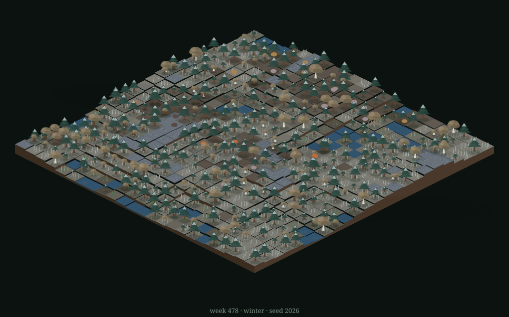

# Grove — a self-contained forest, given one voice by Ollama

<p align="center"></p>

A living forest biome that runs on your machine: ponds, pines, willows,
berry glades, grass, mushrooms — and rabbits, deer, foxes, owls, robins
and boars living, hunting, starving and being born through the seasons.
A **World Soul** decides, roughly every minute, which fate befalls the
woods (a storm, a drought, a blight, a bloom, a passing wolf...); a
language model gives it words, writes the chronicle and names the
newborns — by default `deepseek-v4.1-flash:cloud` through your own
Ollama with small local models behind it (`qwen3:4b-instruct-2507-q4_K_M`
for choices, `gemma3:4b` for prose), and `--tier local` keeps the whole
forest on-box.

No API keys, ever — even the cloud voice comes through your own Ollama.
State lives in one SQLite file. Zero pip dependencies — the engine is
pure Python stdlib, the model runs in Ollama.

```
WEEK 41 · SPRING · 🌧 rain   🐇38 🦌16 🦊9 🦉4 🐦22 🐗6
🌲 🌲 🌱 🟫 🌲 🟨 🌲 🌱 🌳 🌳 ... [24×24 emoji map] ...
 ☾ SOUL ▸ storm NW — "A cold wind is gathering over the western pines."
   ▸ A fox took a wild rabbit at the pond's edge.  (1wk ago)
   ▸ 2 boar slipped in from beyond the forest edge.  (5wk ago)
```

## Requirements

- Python 3.11+ (stdlib only)
- [Ollama](https://ollama.com) running locally

## Quick start

```sh
./grove.sh new --seed 42        # plant a grove (deterministic, no LLM)
./grove.sh run                  # watch it live (LLM in the background)
```

Keys in watch mode: `space` pause · `s` step · `n` invite the soul now ·
`q` quit. Nothing is ever lost — every week is saved to SQLite.

## Viewing it from another device

`grove web` serves a live dashboard over plain HTTP — no build step, works
offline, hand-written files, rendered in **3D with Three.js** (r170,
vendored and shared with the estate under `apps/shared/page3d/`). It is a
**full-screen HUD**: the forest fills the window and the controls float as
translucent panels over it — the chronicle, the census and the tuning tab
**stay open**, because there is room for them beside the world; `c` clears
them when you want the grove alone. Drag to orbit, wheel to zoom,
right-drag to pan.

The scene: the forest floor is a real surface lifted by the engine's
elevation, with the water lying in its hollows, coloured by the season
(the first two weeks of a season blend in from the last). Pines, birches
and willows, ferns and berry bushes (cacti and the rest in the desert)
stand on it at the size their stage gives them; creatures walk to their
weekly cells **round the trunks and the water** — the estate's router on a
quartered grid, so no deer walks through a tree — and the robins fly
straight, hovering over theirs. The light is a **day clock** shared with
the estate: a page day lasts a few weeks of the grove's, close to a minute
and a half of wall time, and the sun crosses the sky continuously rather
than stepping when a week turns. After dark the **mushrooms glow**: the
server sends a light field (`glow` in `/api/state`) and the page lays it
on the floor as one soft pool of light, the way the estate lays its
lamplight. Rain, snow, lightning in storms, fireflies over the water on
summer nights. Click a creature or a tree for its card (named souls show
their biography, born → named → hunted → remembered) with a follow-cam;
ask the grove questions and it answers from the world's own history.
Keys: `space` pause · `s` step · `n` invite the soul · `f` fullscreen ·
`c` calm. `?plain` (or no WebGL) falls back to the emoji page.

Debug parameters: `?phase=dawn|morning|afternoon|evening|night` freezes
the light, `?clock=0.2` pins the day's fraction, `?static=1` draws the
first state and stops (for screenshots), `?view=top` looks straight down.
The page's headless checks: `node tools/hud_check.js` (every model string
escaped), `node tools/viewer_check.js` (the card's ledger ask: kept across
polls, never crossed between creatures, given up after 4 s, re-asked once
a week and never over an ask still waiting), `node tools/route_check.js <state.json>` (no walk crosses a
trunk or water), `node tools/glow_check.js <state.json>
[<next-week.json>]` (about one mushroom ring in three glows on a night,
deterministically, with the server's light arithmetic, and the lit set
holds through a night's weekly rebuilds), and `python3 -m unittest discover -s tests`.

```sh
./grove.sh web                  # loopback only (for an ssh tunnel)
./grove.sh web --public         # reachable from any device on the LAN
```

- **Same network (LAN):** with `--public`, open `http://<this-box-ip>:8787`
  on a phone or laptop. (`hostname -I` shows the address.)
- **Anywhere, if you use Tailscale:** with `--public`, the box's
  Tailscale address (`tailscale ip -4`) works from any tailnet device.
- **Or tunnel, without opening the port:** plain `grove web` (loopback),
  then `ssh -N -L 8787:localhost:8787 yakov@<this-box>` and open
  `http://localhost:8787` on the other machine.
- **No browser at all:** `ssh` in and run `./grove.sh run` inside
  `tmux` (or `nohup ./grove.sh web > grove-web.log 2>&1 &`) — the
  terminal view is the same world, and detach/reattach as you like.

The page's buttons (pause, step, ask, accept/dismiss) are POSTs, and the
server answers them only from the page itself: a JSON body, an `Origin`
(if any) matching the `Host`, and a `Host` it knows. That is loopback
always; with `--public`, also this box's LAN address and the station's
tailnet name (`station.tail8a1a2.ts.net`) and its addresses. Opened by any
other name, the page still shows but its buttons get a 403 — add the name
with `--allow-host NAME` (repeatable). `web` prints the list it answers.

Leave it running detached with `tmux` (recommended), or `nohup` a
server: `nohup ./grove.sh web --public > grove-web.log 2>&1 &`; use
`cron`/`systemd` if you want the grove to wake up on boot.

```sh
./grove.sh step 200 --offline   # simulate 8+ years headless, fast
./grove.sh new --seed 42 --biome desert    # another nature entirely
./grove.sh map                  # render the current map
./grove.sh status               # population history with sparklines
./grove.sh chronicle --all      # the whole chronicle (☾ = LLM-written)
```

`grove.sh` is just `python3 -m grove`; run it from the repo root instead
if you prefer.

## The model

Small-model reality: on a ~2 GHz 4-core CPU there is no GPU and inference
is CPU-bound — ~1.9 tok/s generation on Llama-3.2-3B. The local models
are tuned for slow silicon:

**One model per kind of job.** Every call is one of three kinds, and each
kind has its own flag and default:

| flag | default | used for |
|---|---|---|
| `--choice-model` | `qwen3:4b-instruct-2507-q4_K_M` | the World Soul's operator, the steward's review |
| `--prose-model` | `gemma3:4b` | the chronicle, naming and diaries, ask the grove |
| `--embed-model` | `nomic-embed-text` | ask-the-grove's chronicle vectors |
| `--cloud-model` | `deepseek-v4.1-flash:cloud` | with `--tier cloud`, tried first for every chat job |
| `--decide` | `rules` | `rules`: the choice is made in code (`decide.py`); `llm`: the model picks from the menu, as before |
| `--keep-alive` | `2m` | sent as Ollama's `keep_alive` on every call (`0` unloads at once) |
| `--resident` | `one` | `one`: unload the other local chat model before switching; `many`: leave that to Ollama |
| `--model-lock` | `/tmp/llm-world-ollama.lock` | the file every llm-world process locks around a call; empty = in-process only |
| `--model NAME` | — | pin every chat job to exactly one model (any tag Ollama has, cloud or local) |

`--tier cloud` (the default) puts the cloud model in front of each job and
falls back to that job's local model, then the other local model, then
`llama3.2:3b` if it happens to be installed; `--tier local` never leaves
the box. Pull the defaults once:

```sh
ollama pull qwen3:4b-instruct-2507-q4_K_M
ollama pull gemma3:4b
ollama pull nomic-embed-text
```

(There is no bare `qwen3:4b-instruct-2507` tag; use the quantised one.)

**Choices are made in code; the model writes the words.** With
`--decide rules` the menu question is answered by `decide.py`: a
deterministic, seeded weighting of what the world is showing (the
SystemOne shape — `{type, probs, pick, confidence}` per question), passed
through the same validator a model's answer is. The model is then asked
only for language — the soul's intent and a destiny's text, the steward's verdict — under a small schema sent as Ollama's
`format`. No model, a missing model or a full queue lands the same choice
with a template line, so the world moves the same way with or without a
model. `--offline` (AI off) never runs `decide` at all, so offline worlds
and their fingerprints are unchanged.

**A missing model says so.** Each job's chain is filtered to what Ollama
has installed (`/api/tags`; a bare name matches `:latest`, a `:cloud` name
may be confirmed by `/api/show`). The status line in the HUD and the
`models` block in `/api/state` name each job's model, and a job whose
model is not installed is reported — `not installed: gemma3:4b (jobs on
templates)` — instead of failing as a silent 404. A 404 mid-run marks the
model missing and moves the job along its chain. An unreachable Ollama is
re-probed every 60 s; a model pulled while it runs is picked up the same
way.

**Request shape.** Schemas go in `format`. `think: false` is sent only to
local tags that would otherwise think (qwen3 tags without `instruct`,
smollm3); instruct tags, gemma and cloud models get no `think` key, and
cloud calls get extra token headroom for their hidden reasoning.

**Memory on a small box.** The station is a Raspberry Pi 5 with 16 GB and
a 2 GB swap that is already well used, and the estate and the grove share
one Ollama. A 4B q4 model is ~2.5–3.5 GB resident, so qwen and gemma
together, plus nomic, plus the sims, pushes the Pi into swap and every
call crawls. So:

- calls are **serialised** — one at a time within a process (a lock), and
  across the estate and the grove by an `flock` on `--model-lock`;
- with `--resident one` the other local chat model is unloaded (via
  `keep_alive: 0`) before a different one is used, so qwen and gemma are
  never both loaded; the embedder (small) and cloud models are exempt;
- `--keep-alive 2m` lets a model go two minutes after its last call
  rather than Ollama's default five. On a bigger box, `--resident many
  --keep-alive 10m` keeps both warm.

- The world never waits on the model: the sim ticks happily while the
  soul ponders, and results land at the next week boundary.

`grove run --offline` (or a missing/unreachable model) gives the same
world with deterministic template prose instead of LLM prose.

## The ecology

A layered forest: **one tree per cell** (a grove, not a wall) with an
understory pocket beneath it — ferns and berry bushes live in the
canopy's shade. The food web is small and legible by design: ~24 rabbits,
14 robins, 10 deer, 6 foxes, 3 owls, 5 boars — each one a character you
can name, follow and lose.

- **Seed bank**: every seed that fails to land sleeps in the soil
  instead of dying; when a species dwindles, autumn lets the bank speak
  into genuinely suitable spots (light, water, crowding aware). The soil
  is memory, not a ledger — the forest can never lose a species forever.
- **Succession**: birches are pioneers that open up ground, pines slow
  and shade-tolerant, willows tied to the pond's edge, ferns shade-loving,
  berry bushes fruiting in spring and rooting clones next door. Dead
  trunks decay into **humus** that feeds mushrooms (the boars' winter
  food) and tree recovery.
- **The robin migration**: at the frost, every robin flies south; come
  spring three of four springs they return. Winter is a season without
  song, and the owls then live on rabbits alone.
- **Density-dependent predation**: foxes and owls hunt less efficiently
  when the warren is thin — the boom-bust loop that keeps collapse away.
- `tools/balance.py` is the gate: 8 seeded worlds × 19 years must keep
  every species alive or the change doesn't ship.

## How it stays robust (the one design rule)

> The simulation engine owns ALL state. The LLM never holds the world in
> context and never writes world state. It gets small, bounded jobs with
> schema-validated outputs and deterministic fallbacks.

- **World Soul** — roughly one decision every minute (wall time; the
  cloud soul every 40–80 s, the offline llama every 60–120 s):
  one choice from an enumerated menu
  (`storm, drought, blight, bloom, migration, visitor, destiny, quiet`),
  made in code by `decide.py` (`--decide rules`, the default) or by the
  model from a ≤ 400-token digest (`--decide llm`), applied by validated,
  deterministic rules. The model writes only the intent; no model → the
  same move with a template line. Nonsense in → `quiet` out.
- **Chronicler** — notable events are described by template lines the
  instant they happen; a background call rewrites them when the model is
  ready (☾), rejecting lines that hallucinate off-event, restate the
  data, or echo recent lines. Same-week stories fold into one counted
  line ("5 pines are fallen — great age"). Every line is cached by
  event signature, so replays and
  `--offline` runs cost nothing.
- **Voice** — newborns and elder trees get names (one-word JSON, charset
  validated, list fallback), sometimes with a one-line diary.

The engine (`grove/sim.py`) is fully deterministic per seed: same seed +
same actions ⇒ same world. Tuning constants sit at the top of that file;
the food web is gated by `tools/balance.py` (many seeded worlds × years,
all species must persist).

## Layout

| path | role |
|---|---|
| `grove/engine/` | the tick's domains: weather/soil, plants, animals, the population's nets, the operator's fates |
| `grove/biomes/` | a world's nature as packs: `grove.py`, `desert.py` (species, recipes, words, colours, shapes) |
| `grove/page3d/` | the 3D dashboard: `index.html`, `style.css`, `hud.js` (panels, all text escaped), `forest.js` (trunks and the walk grid), `glow.js` (which mushroom rings glow tonight), `world.js` (the Three.js scene), `viewer.js` (polling and input); the shared clock, router, light field and Three.js come from `apps/shared/page3d/` |
| `grove/world.py` | state containers, species-table aliases, helpers |
| `grove/gen.py` | seeded worldgen (no LLM) |
| `grove/sim.py` | the tick engine + validated operator effects |
| `grove/events.py` | which events are chronicle-worthy |
| `grove/operator.py` | World Soul: digest, menu schema, validation, the words |
| `grove/decide.py` | the soul's move and the steward's amendments chosen in code |
| `grove/chronicler.py` | narration prompts + template fallbacks |
| `grove/voice.py` | naming |
| `grove/memory.py` | ask-the-grove: chronicle retrieval + answer |
| `grove/llm.py` | Ollama client: a model per job, missing-model status, one call at a time |
| `grove/render.py` | the emoji map + header + chronicle feed |
| `grove/db.py` | SQLite: world, stats, events, chronicle, cache, biographies |
| `grove/app.py` | shared runner (used by CLI and web) |
| `grove/web.py` | the dashboard's server: the state JSON, the light field, the 3D page's files |
| `grove/__main__.py` | CLI + run loop |
| `tools/balance.py` | the ecologist's gate: seeded worlds × years, all must pass |
| `tools/hud_check.js` | the HUD's escaping check: hostile strings in every field must come out inert |
| `tools/viewer_check.js` | the card's ask check: the real viewer.js with a stub DOM and clock — the ledger's answer survives polls, a late answer never lands on another card, a hung ask fails plainly |
| `tools/route_check.js` | the walk check: every creature's route on a snapshot avoids trunks and water |
| `tools/glow_check.js` | the glow check: tonight's lit rings on a snapshot — deterministic, about one in three with no rota, never none, whole rings, the server's field when all are lit; given next week's snapshot too, no surviving ring flips in the dark |
| `tests/` | the server's routes and headers, the light field, and the checks above (with mutants) |
| `tools/render_svg.py` | the README's scene, rendered from the live world |
| `docs/ARCHITECTURE.md` | how it all works: tick order, contracts, threads |
| `docs/ECOLOGY.md` | the field guide: how the biome's mechanics work |
| `docs/TUNING.md` | the honest numbers: species knobs, tempo, the gate |

## Ideas on the shelf

- playable character mode (walk in and talk to the animals)
- the time-travel scrubber (replay any stretch of the world's past)
- an offline soundscape: procedural wind, rain and a distant wolf
- the book of grove: seasonal reflections + a saga export
- seasons' effect on names ("the winter fox"), wolf packs, bear dens